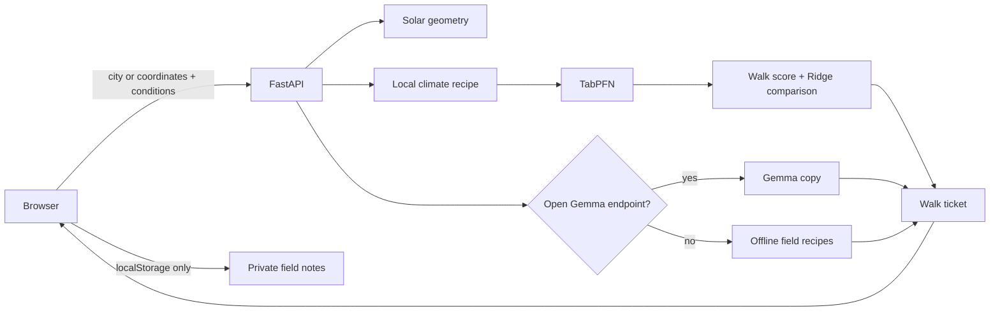

# Last Light

<p align="center">
  
</p>

<p align="center">
  <strong>The screen is the shortest part.</strong><br>
  A local-first dusk walk ticket that gets you outside, then gets out of the way.
</p>

<p align="center">
  <a href="https://github.com/vannu07/Touch-Grass/actions"></a>
  <a href="https://github.com/vannu07/Touch-Grass"></a>
  <a href="https://www.python.org/"></a>
  <a href="https://fastapi.tiangolo.com/"></a>
  <a href="https://dev.to/challenges/hacktoberfest-week1-2026-10-05"></a>
</p>

> **Last Light** turns sunset geometry, local climate signals, and open-weight AI into a small printed-style brief: when to leave, which way to walk, four sensory prompts, and one rule — put the phone away.


## Why it exists

Most outdoor apps increase screen time. Last Light is deliberately the opposite:

- **Prepare on screen.** Calculate the useful facts before leaving.
- **Carry a ticket.** Print it, read it aloud, or remember the four cues.
- **Pocket the phone.** Pocket Mode becomes a simple countdown.
- **Notice the ordinary.** There is no feed, streak, destination, or species database.

The best interface is the one you stop looking at.

## What the experience feels like

1. Choose a city or use your door.
2. Set the walk length, date, temperature, ground, and sky.
3. Receive a dusk ticket with a leave-by time, sunset, heading, score, route, and field cues.
4. Print the stub or start Pocket Mode.
5. Walk. Write a private three-line note when you return.

### The ticket includes

| Signal | What it gives you |
| --- | --- |
| Solar geometry | Sunrise, sunset, golden hour, civil dusk, day length, and sunset azimuth |
| Walk score | TabPFN prediction with a Ridge baseline and held-out MAE |
| Field route | A destination-free route toward the sunset heading |
| Four cues | Look, listen, touch, and notice prompts |
| Pocket Mode | A full-screen timer designed to be left alone |
| Private notes | Stored locally in your browser; never sent to the API |

## Open AI, used on purpose

The open components are not decoration. They make the product practical:

- **TabPFN** scores whether the conditions are worth a walk from a generated dusk dataset.
- **Gemma** writes the ticket when Ollama or another compatible endpoint is available.
- **Local field recipes** keep the experience useful without a model, API key, or internet connection.
- **FastAPI and vanilla web technologies** keep the system inspectable and easy to run on a laptop.

The model works before the walk. The walk itself is intentionally low-tech.

## Architecture



## Run locally

### Requirements

- Python 3.11 or newer
- 2 GB+ RAM recommended for the optional TabPFN model
- Ollama is optional

```bash
git clone https://github.com/vannu07/Touch-Grass.git
cd Touch-Grass
python -m venv .venv
```

Windows:

```powershell
.venv\Scripts\Activate.ps1
python -m pip install -r requirements.txt
python -m pytest -q
python -m uvicorn lastlight.app:app --reload --port 8765
```

macOS/Linux:

```bash
source .venv/bin/activate
python -m pip install -r requirements.txt
python -m pytest -q
python -m uvicorn lastlight.app:app --reload --port 8765
```

Open [http://127.0.0.1:8765](http://127.0.0.1:8765).

The first TabPFN fit may download model weights and take a little longer on CPU. The interface remains available while the engine loads. Check `/api/health` for the current backend and backtest metrics.

## Optional Gemma copy

Run Gemma locally with Ollama:

```bash
ollama pull gemma3:4b
```

Then set the model name:

Windows PowerShell:

```powershell
$env:OLLAMA_MODEL = "gemma3:4b"
```

macOS/Linux:

```bash
export OLLAMA_MODEL=gemma3:4b
```

If no endpoint is available, Last Light uses its deterministic offline field recipes. This is an intentional product mode, not an error state.

## Optional voice

Set `ELEVENLABS_API_KEY` to enable server-side narration. Without it, the browser's built-in speech synthesis is used.

```env
ELEVENLABS_API_KEY=your_key_here
ELEVENLABS_VOICE_ID=JBFqnCBsd6RMkjVDRZzb
```

Never commit `.env`; it is ignored by Git.

## Deploy

### Vercel

This repository includes [`pyproject.toml`](pyproject.toml) with the FastAPI entrypoint required by Vercel:

```toml
[tool.vercel]
entrypoint = "lastlight.app:app"
```

Import the repository into Vercel and deploy. The Python function is exported from `lastlight.app:app`.

### Render

The repository includes [`render.yaml`](render.yaml) as a Blueprint:

```bash
uvicorn lastlight.app:app --host 0.0.0.0 --port $PORT
```

### Docker

```bash
docker build -t last-light .
docker run --rm -p 8765:8765 last-light
```

## Project map

```text
lastlight/
  app.py       FastAPI routes, validation, ticket orchestration
  climate.py   Generated climate table and walk features
  copy.py      Gemma adapters and offline field recipes
  places.py    Small city catalogue
  predict.py   TabPFN engine and Ridge baseline
  sun.py       Solar position and sunset calculations
web/
  index.html   Accessible ticket interface
  app.js       Ticket flow, Pocket Mode, voice, local notes
  styles.css   Editorial dusk visual system and print styles
tests/
  test_sun.py
  test_climate.py
docs/
  last-light-preview.svg  Animated README visual
```

## Privacy and safety

- Location is used to issue a ticket and is not persisted by the server.
- Field notes use browser `localStorage`.
- No maps, tracking pixels, or weather API are required.
- The score is an experiment, not a guarantee about safety or weather.
- Do not walk somewhere unsafe, trespass, or continue after it is dark.

## Validation

```bash
python -m pytest -q
```

The tests cover solar calculations, generated dataset shape, and the climate recipe's rainfall penalty. The server logs the model backtest:

```text
[lastlight] go-engine tabpfn tabpfn_mae=... ridge_mae=... mean_mae=... n_test=...
```

## Hacktoberfest challenge fit

| Criterion | How Last Light answers it |
| --- | --- |
| Touch Grass | The screen prepares the walk and Pocket Mode gets out of the way |
| Open-source AI | TabPFN and Gemma are first-class, swappable components |
| Creativity | A destination-free, printable dusk ticket instead of another feed |
| Technical execution | Solar geometry, ML backtest, graceful offline mode, voice, print CSS |
| Privacy | Local notes and no required weather or map service |

## License

MIT. See [LICENSE](LICENSE).
